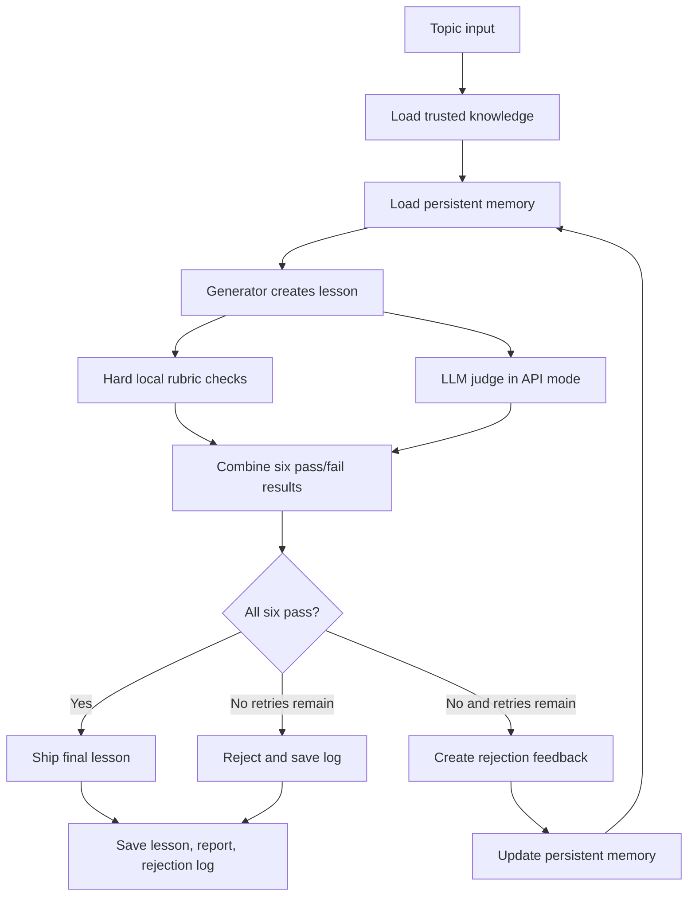

# Architecture and Design Decisions

## 1. Goal

Build a small agentic content system, not a one-prompt text generator. It must create a standalone beginner lesson, inspect its own output, explain rejection reasons, revise the lesson, and stop within a fixed retry budget.

## 2. Pipeline

## 3. Main components

### Generator

`lesson_agent/providers.py` contains two interchangeable providers:

- **MockProvider:** deterministic and offline. It intentionally returns an incomplete lesson on the first attempt when `--demo` is used, then returns a complete lesson. This allows a reviewer to see rejection and regeneration without depending on an API or internet connection.
- **OpenAIProvider:** uses an LLM to create the lesson and a separate judge request to evaluate it. Trusted knowledge, rubric dimensions, previous failures, and memory rules are passed into the relevant prompts.

The two providers share the same interface, so the orchestration code does not need provider-specific branches.

### Evaluator

`lesson_agent/evaluator.py` applies six binary checks. Local rules verify the structure and measurable requirements. When API mode is enabled, the LLM judge also checks meaning and factual consistency. A check passes only if both its local gate and its LLM judgment pass.

### Retry controller

`lesson_agent/agent.py` owns the loop. It permits one first attempt and at most two retries. A failure is translated into named feedback and sent to the next generation request. There is no unbounded loop.

### Persistent memory

`lesson_agent/memory.py` stores run counts, failed-check counts, recent failure summaries, and reusable instructions. The memory is loaded at the beginning of a run and written after each attempt. The next generation uses the most frequent learned instructions.

### Grounding data

`data/knowledge_base.md` provides a compact, trusted factual boundary. The generator is instructed not to make claims outside it; the evaluator receives the same notes to check accuracy.

## 4. Why a hybrid evaluator?

An LLM is useful for judging whether an explanation is understandable or factually faithful, but an LLM judge can be inconsistent. Simple requirements such as “the lesson must include a limitation section” or “the example must have three steps” are cheaper and easier to verify with deterministic code.

The hybrid design uses code for objective structure and guardrails, and an LLM judge for semantic quality. In API mode, both must pass. This makes the final decision more conservative.

## 5. Why hard pass/fail gates?

The assessment asks for explicit pass/fail checkpoints without partial credit. The system therefore does not average scores. A lesson with five passes and one failure is rejected. This avoids allowing a strong example to hide a factual problem.

## 6. Why keep the rubric fixed?

Memory changes the generation guidance, not the evaluator's standard. If the agent rewrote its own rubric after a failure, it could make the criteria easier and appear to improve without actually improving the lesson. The system instead learns reusable corrections while keeping the same quality bar.

## 7. Trade-offs and limitations

- The local readability test uses average sentence length and minimum lesson length. These are useful guardrails, not a complete measure of readability.
- The local jargon test checks a required glossary. A future version could use a larger, topic-specific glossary or reading-level analysis.
- The LLM judge may still make mistakes. High-impact educational content should include human review and source verification.
- The included knowledge notes are intentionally small. A production system would ingest files, preserve source metadata, retrieve relevant excerpts, and cite them in the generated lesson.
- JSON memory is suitable for a take-home demo and a single user. A production service may need a database, run IDs, concurrency protection, and memory retention controls.

## 8. Reliability and termination

`max_retries` is validated to be between zero and two. The loop uses a finite range, so even a provider that repeatedly fails evaluation cannot run forever. Each attempt is recorded in `run_report.json`, and each failed check is recorded in `rejection_log.md`.
